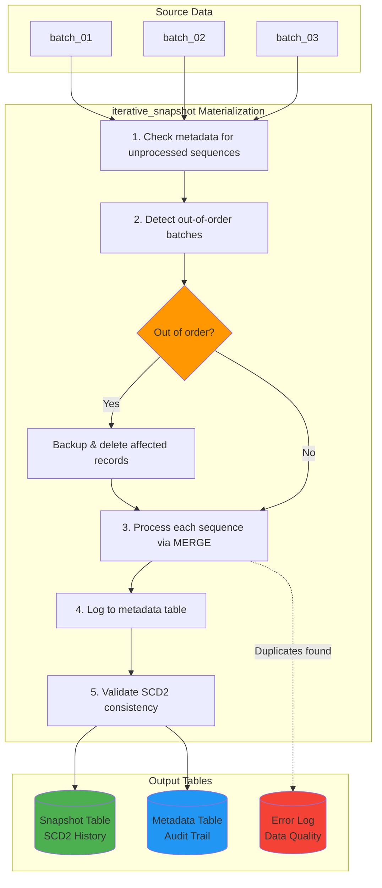
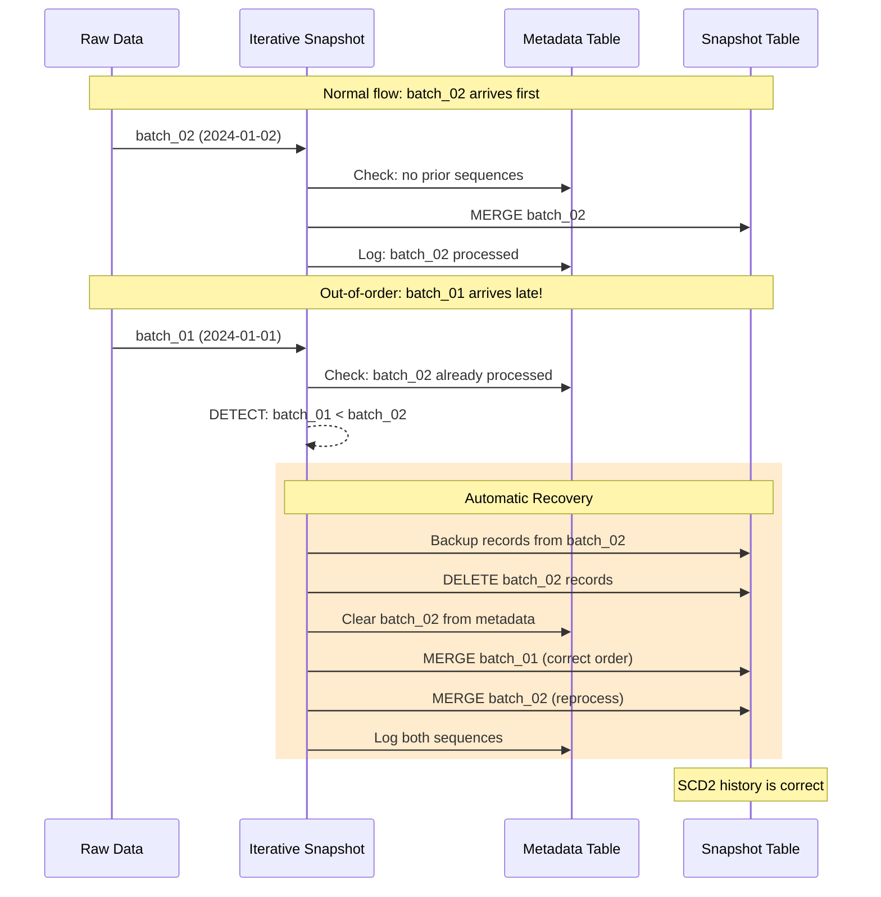

# dbt-iterative-snapshot

> **SCD2 snapshots that process data batches in sequence — even when they arrive out of order.**

[](https://getdbt.com)
[](https://databricks.com)
[](LICENSE)


> **Note**: This is an open source project by Mercedes-Benz Group AG. Source code has been tested solely for our own use cases, which might differ from yours.

---

## Why This Package?

Standard dbt snapshots assume your source is a single live table that you query once per run. But many real-world data pipelines receive **sequential batches** — daily file exports, CDC streams, API syncs — and those batches don't always arrive in order.

**When batches arrive out of order, standard snapshots corrupt your SCD2 history.** Records show impossible timelines — changes appearing *before* they happened.

`dbt-iterative-snapshot` solves this by processing batches **in sequence order**, automatically detecting and correcting out-of-order arrivals, and producing a correct SCD2 history table — no manual intervention required.

---

## Key Features

| Feature | What It Does |
|---------|--------------|
| **Sequence-Based Processing** | Processes batches in the order defined by your `sequence_by` column, not arrival order |
| **Out-of-Order Self-Healing** | Automatically detects late batches, backs up affected records, and reprocesses in correct order |
| **Full Refresh with History Preservation** | Rebuilds your snapshot without losing historical records outside the raw data retention window |
| **Change Tracking** | `changed_attributes` column shows exactly which fields changed in each update (not just *that* something changed) |
| **Data Quality Monitoring** | Detects duplicate keys within a batch, logs errors to a dedicated table, validates SCD2 timeline consistency |
| **Metadata Audit Trail** | Tracks every processed batch — answer "what was processed and when?" with certainty |
| **Batch Reprocessing** | Delete a metadata entry and re-run to reprocess any specific batch on demand |

---

## The Problem

You receive daily data batches. Monday's arrives, then Wednesday's — but Tuesday's is delayed:

```
Arrival order:    batch_01 → batch_03 → batch_02 (late!)
Correct order:    batch_01 → batch_02 → batch_03
```

**With standard dbt snapshots**: Tuesday's late batch corrupts your SCD2 history.

**With iterative-snapshot**: The package detects the out-of-order batch, backs up affected records, reprocesses from Tuesday onwards, and restores correct SCD2 history — automatically.

---

## 30-Second Example

```sql
-- models/employee_history.sql
{{ config(
    materialized='iterative_snapshot',
    unique_key='employee_id',
    updated_at='modified_date',
    sequence_by='batch_date',
    strategy='check',
    check_cols=['department', 'salary', 'status']
) }}

SELECT * FROM {{ source('hr', 'employee_data') }}
```

That's it. The `sequence_by` column tells the package *which order* to process batches, regardless of when they physically arrived.

**Output**: A complete SCD2 history table with `dbt_valid_from`, `dbt_valid_to`, `dbt_change_type`, and `changed_attributes`.

---

## When to Use This Package

| Your Scenario | Standard Snapshot | Iterative Snapshot |
|---------------|:-----------------:|:-----------------:|
| Source is a live database table (one snapshot per run) | Yes | — |
| Source is sequential batches (files, CDC, API syncs) | — | **Yes** |
| Batches can arrive out of order | Corrupts history | **Handles automatically** |
| Need to reprocess/backfill historical batches | Manual rebuild | **Built-in** |
| Want audit trail of which batches were processed | — | **Included** |
| Need to know *which columns* changed per update | — | **`changed_attributes`** |

---

## Community Demand

This package addresses long-standing gaps in dbt's snapshot functionality — issues that have been open for 3+ years with hundreds of reactions:

| dbt-core Issue | Problem | How We Solve It |
|----------------|---------|-----------------|
| [#7138](https://github.com/dbt-labs/dbt-core/issues/7138) | Non-chronological insertions corrupt SCD2 | Detects out-of-order sequences, reprocesses in correct order |
| [#9892](https://github.com/dbt-labs/dbt-core/issues/9892) | No way to backfill or rebase snapshots | Sequence-based processing + `--full-refresh` with history preservation |
| [#3878](https://github.com/dbt-labs/dbt-core/issues/3878) | Snapshots can't handle append-only sources | Processes one sequence at a time, preventing merge conflicts |

---

## Installation

```yaml
# packages.yml
packages:
  - package: mercedes-benz/dbt_iterative_snapshot
    version: [">=1.0.0", "<2.0.0"]
```

```bash
dbt deps
```

---

## Quick Start

### Step 1: Define Your Source

Your source data needs a **sequence column** — a column that identifies which batch each record belongs to (e.g., `batch_date`, `file_id`, `load_timestamp`, `kafka_offset`).

```yaml
# models/sources.yml
sources:
  - name: raw
    tables:
      - name: customer_updates
        description: "Daily customer data batches"
```

### Step 2: Create Your Snapshot Model

```sql
-- models/snapshots/customer_history.sql
{{ config(
    materialized='iterative_snapshot',
    unique_key='customer_id',
    updated_at='modified_date',
    sequence_by='batch_date',
    strategy='check',
    check_cols=['name', 'email', 'status']
) }}

SELECT
    customer_id,
    name,
    email,
    status,
    modified_date,
    batch_date
FROM {{ source('raw', 'customer_updates') }}
```

### Step 3: Run It

```bash
dbt run --select customer_history
```

---

## How It Works

### Processing Flow



### Example: Processing Daily Batches

**Day 1**: Batch `2024-01-01` arrives with initial customer data:

| customer_id | name | status | batch_date |
|-------------|------|--------|------------|
| 1 | Alice | Active | 2024-01-01 |
| 2 | Bob | Active | 2024-01-01 |

**Day 2**: Batch `2024-01-02` arrives with updates:

| customer_id | name | status | batch_date |
|-------------|------|--------|------------|
| 1 | Alice | Premium | 2024-01-02 |
| 3 | Carol | Active | 2024-01-02 |

**Result**: SCD2 snapshot table with full history:

| customer_id | name | status | dbt_valid_from | dbt_valid_to | dbt_change_type | changed_attributes |
|-------------|------|--------|----------------|--------------|-----------------|-------------------|
| 1 | Alice | Active | 2024-01-01 | 2024-01-02 | insert | NULL |
| 1 | Alice | Premium | 2024-01-02 | NULL | update | ["status"] |
| 2 | Bob | Active | 2024-01-01 | NULL | insert | NULL |
| 3 | Carol | Active | 2024-01-02 | NULL | insert | NULL |

### Out-of-Order Handling



---

## Configuration Reference

### Required Parameters

| Parameter | Type | Description |
|-----------|------|-------------|
| `materialized` | string | Must be `'iterative_snapshot'` |
| `unique_key` | string or list | Primary key column(s) for SCD2 tracking |
| `updated_at` | string | Timestamp column from source system |
| `sequence_by` | string | Column that defines batch processing order |
| `strategy` | string | `'check'` (column comparison) or `'timestamp'` (timestamp-based) |
| `check_cols` | list or `'all'` | Columns to monitor for changes |

### Optional Parameters

| Parameter | Default | Description |
|-----------|---------|-------------|
| `invalidate_hard_deletes` | `false` | Track when records disappear from source |
| `enable_data_quality_checks` | `true` | Detect duplicate keys within same sequence |

### Project-Level Configuration

```yaml
# dbt_project.yml
vars:
  enable_data_quality_checks: true
  enable_error_logging: true
  enable_consistency_checks: true
  enable_temp_views: true
  enable_clustering: true
  metadata_schema: "dbt_iterative_snapshot_metadata"
```

---

## Output Tables

### Snapshot Table (your model)

Your SCD2 history with these additional columns:

| Column | Description |
|--------|-------------|
| `dbt_scd_id` | Unique hash for each record version |
| `dbt_valid_from` | When this version became active |
| `dbt_valid_to` | When superseded (NULL = current record) |
| `dbt_updated_at` | Source system timestamp |
| `dbt_change_type` | `insert`, `update`, or `delete` |
| `changed_attributes` | JSON array of columns that changed (NULL for inserts) |
| `inserted_at` | When the row was written to the snapshot |

### Metadata Table (audit trail)

Tracks every batch processed:

| Column | Description |
|--------|-------------|
| `model_name` | Your snapshot model name |
| `sequence` | The batch/sequence value processed |
| `invocation_id` | dbt run ID |
| `run_started_at` | When processing started |

### Error Log (data quality)

Records issues found during processing:

| Column | Description |
|--------|-------------|
| `model_name` | Snapshot model name |
| `sequence` | Batch with the issue |
| `unique_key` | The duplicate key value |
| `corrupted_record` | Full record data (JSON) |

### Querying Examples

```sql
-- Current records
SELECT * FROM my_snapshot WHERE dbt_valid_to IS NULL;

-- Full history for one entity
SELECT * FROM my_snapshot 
WHERE customer_id = 123 
ORDER BY dbt_valid_from;

-- Which batches have been processed?
SELECT * FROM my_catalog.metadata_schema.iterative_snapshot_metadata
WHERE model_name = 'my_snapshot'
ORDER BY sequence;

-- Any data quality issues?
SELECT * FROM my_catalog.metadata_schema.iterative_snapshot_error_log
WHERE model_name = 'my_snapshot';
```

---

## Advanced Usage

### Composite Unique Key

```sql
{{ config(
    materialized='iterative_snapshot',
    unique_key=['region', 'customer_id'],
    updated_at='modified_date',
    sequence_by='batch_date',
    strategy='check',
    check_cols='all'
) }}
```

### Hard Delete Tracking

```sql
{{ config(
    ...
    invalidate_hard_deletes=true
) }}
```

### Full Refresh with History Preservation

```bash
dbt run --select customer_history --full-refresh
```

This will:
1. Back up historical records outside the raw data retention window
2. Rebuild the snapshot from current raw data with your current config
3. Restore the historical records — preserving full SCD2 history

### Rebasing After Strategy Changes

Changed your `check_cols`? Use `--full-refresh` to reprocess all data with the new strategy:

```bash
dbt run --select customer_history --full-refresh
```

Historical records outside your raw data retention window are preserved but not reprocessed (the original data is no longer available).

### Reprocessing a Specific Batch

Delete its metadata entry and re-run:

```sql
DELETE FROM your_catalog.metadata_schema.iterative_snapshot_metadata
WHERE model_name = 'my_snapshot' AND sequence = '2024-01-15';
```

```bash
dbt run --select my_snapshot
```

---

## Performance Tips

1. **Temporary views** (enabled by default) reduce repeated query compilation across sequences
2. **Liquid clustering** (enabled by default) optimizes Delta Lake table layout
3. For trusted data, disable checks for speed:
   ```sql
   {{ config(
       ...
       enable_data_quality_checks=false,
       enable_consistency_checks=false
   ) }}
   ```

---

## FAQ

### What's the difference between `updated_at` and `sequence_by`?

- **`updated_at`**: When the record was modified in the source system
- **`sequence_by`**: Which batch the record belongs to (controls processing order)

Example: A record modified on Jan 15 (`updated_at`) might arrive in the Jan 20 batch (`sequence_by = '2024-01-20'`).

### What can I use as a `sequence_by` value?

Any monotonically increasing value that identifies your batches:
- Dates: `batch_date`, `snapshot_date`, `export_date`
- IDs: `batch_id`, `load_id`, `file_id`
- Timestamps: `load_timestamp`, `extracted_at`
- Offsets: `kafka_offset`, `cdc_sequence`

### Does this work with non-Databricks platforms?

Currently this package is built for **Databricks** (Delta Lake, Unity Catalog, Databricks SQL). It uses platform-specific features like `MERGE`, `PARSE_JSON`, liquid clustering, and Unity Catalog schema management.

---

## Troubleshooting

| Issue | Cause | Solution |
|-------|-------|----------|
| "No object to process" | All sequences already processed | Check for new data or use `--full-refresh` |
| Duplicate key errors in log | Multiple records with same key in one batch | Clean source data or adjust `unique_key` |
| Out-of-order reprocessing slow | Rebuilding many sequences | Ensure batches arrive in order when possible |
| Metadata table not found | Schema doesn't exist | Create schema or update `metadata_schema` var |

For more details, see [docs/TROUBLESHOOTING.md](docs/TROUBLESHOOTING.md).

---

## Requirements

- **dbt**: 1.6.0 or higher
- **Databricks**: Runtime 10.4+
- **Unity Catalog**: Recommended (for 3-part naming and schema management)

---

## Contributing

We welcome contributions! See [CONTRIBUTING.md](CONTRIBUTING.md) for guidelines.

## Code of Conduct

Please read our [Code of Conduct](CODE_OF_CONDUCT.md) as it is our base for interaction.

## License

This project is licensed under the [MIT License](LICENSE).

## Provider Information

Please visit [https://group.mercedes-benz.com/provider/](https://group.mercedes-benz.com/provider/) for more information on the provider Mercedes-Benz Group AG.

**Notice**: Before you use this program in productive use, please take all necessary precautions such as testing and verifying the program with regard to your specific use. The source code has been tested solely for our own use cases, which might differ from yours.
