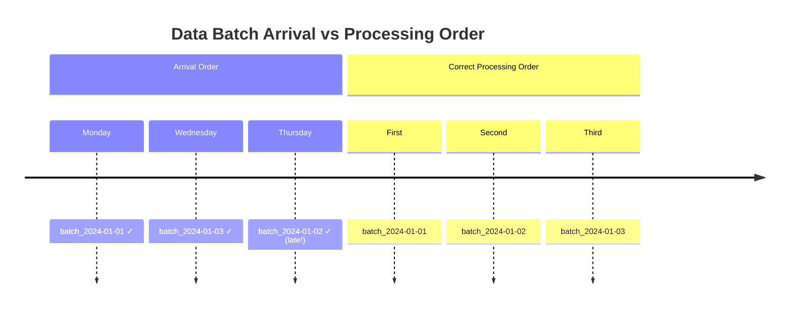
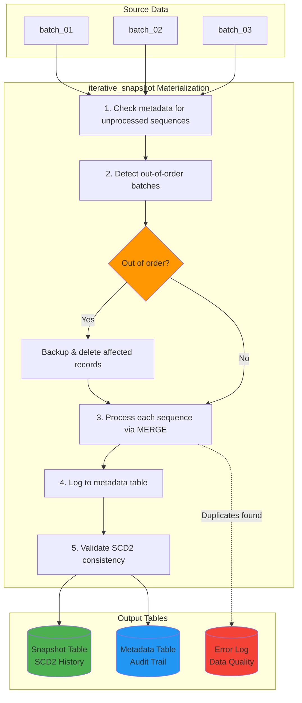
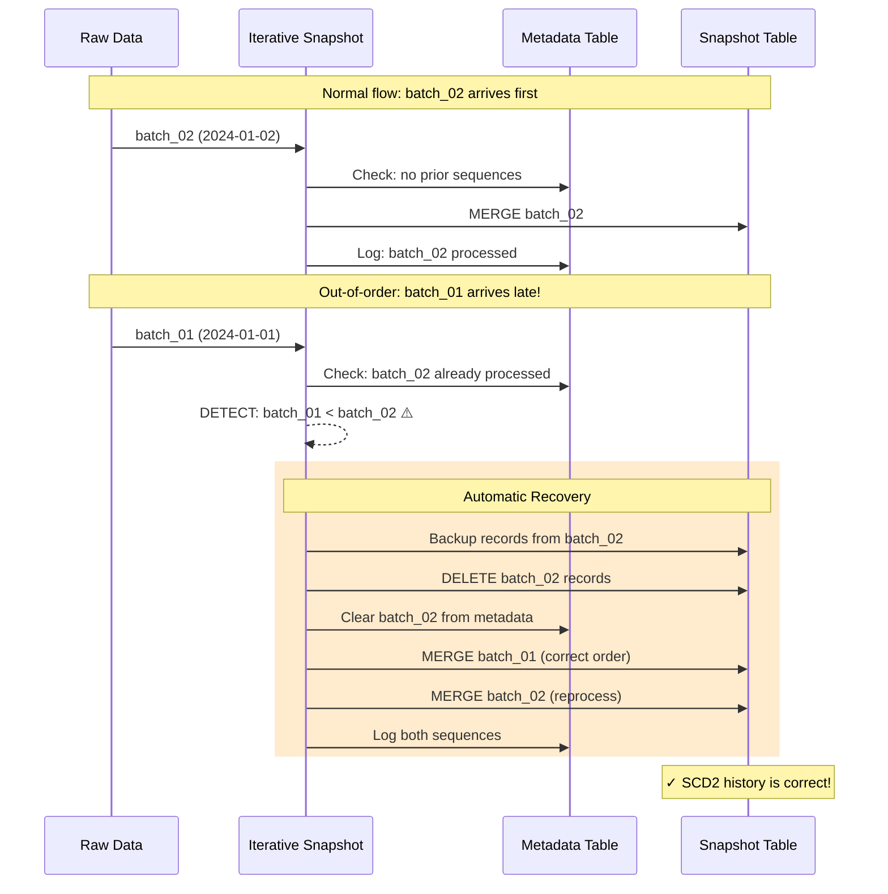
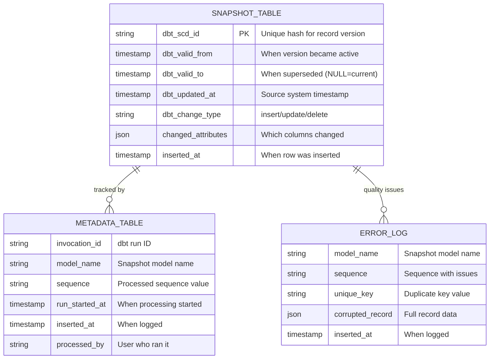
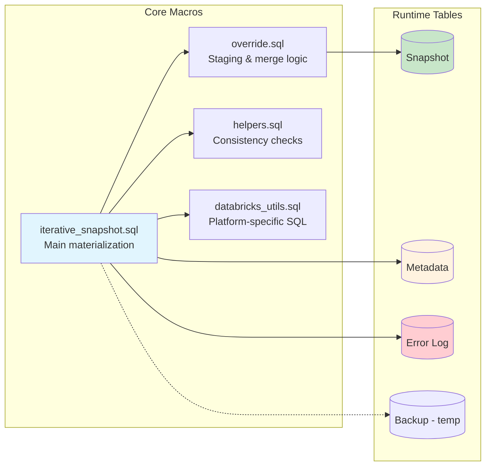
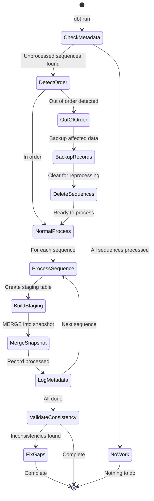

# dbt-iterative-snapshot

> **SCD2 snapshots that process data batches in sequence — even when they arrive out of order**

[](https://getdbt.com)
[](https://databricks.com)
[](LICENSE)

> **Note**: This is an open source project by Mercedes-Benz Group AG. Source code has been tested solely for our own use cases, which might differ from yours.

---

## The Problem

You receive daily data batches — whether from file exports, database snapshots, CDC streams, or API syncs. Monday's batch arrives, then Wednesday's — but Tuesday's batch is delayed:



**With standard dbt snapshots**: Tuesday's late batch corrupts your SCD2 history. Records show impossible timelines — changes appearing *before* they happened.

**With iterative-snapshot**: The package detects the out-of-order batch, backs up affected records, reprocesses from Tuesday onwards, and restores correct SCD2 history automatically.

---

## 30-Second Example

```sql
-- models/employee_history.sql
{{ config(
    materialized='iterative_snapshot',
    unique_key='employee_id',
    updated_at='modified_date',
    sequence_by='batch_date',        -- processes batches in this order
    strategy='check',
    check_cols=['department', 'salary', 'status']
) }}

SELECT * FROM {{ source('hr', 'employee_data') }}
```

**Input**: 3 daily batches with employee changes  
**Output**: Complete SCD2 history table with `dbt_valid_from`, `dbt_valid_to`, and `dbt_change_type`

The `sequence_by` column is the key — it tells the package *which order* to process batches, regardless of when they physically arrived.

---

## When to Use This Package

| Scenario | Standard Snapshot | Iterative Snapshot |
|----------|:-----------------:|:-----------------:|
| Source is a live database table (single snapshot per run) | ✅ | — |
| Source is sequential data batches (files, CDC, API syncs) | — | ✅ |
| Batches can arrive out of order | ❌ | ✅ |
| Need to reprocess historical batches | ❌ | ✅ |
| Want audit trail of processed batches | — | ✅ |

---

## Why This Package Exists

> **Standard dbt snapshots assume your data arrives in order. Real-world data doesn't.**

### The 3 Guarantees

| Guarantee | What It Means |
|-----------|---------------|
| **Safe Backfill** | Load a month-old file without losing data — records automatically slot into correct SCD2 positions |
| **Self-Healing History** | Out-of-order batches are detected and reprocessed automatically — no corrupted timelines |
| **Audit-Ready** | Every batch is logged with metadata — answer "what was the state on date X?" with certainty |

### Community Demand

This package addresses long-standing gaps in dbt's snapshot functionality that remain unresolved after years of community requests:

| dbt-core Issue | Problem | How We Solve It |
|----------------|---------|-----------------|
| [#7138](https://github.com/dbt-labs/dbt-core/issues/7138) | Non-chronological insertions corrupt SCD2 history | Detects out-of-order sequences, backs up affected records, reprocesses in correct order |
| [#9892](https://github.com/dbt-labs/dbt-core/issues/9892) | No way to backfill or rebase historical snapshots | **Backfill**: sequence-based processing loads historical batches in correct order. **Rebase**: `--full-refresh` rebuilds with new strategy while preserving history outside retention window |
| [#3878](https://github.com/dbt-labs/dbt-core/issues/3878) | Snapshots can't handle append-only source tables | Processes one sequence at a time, preventing merge conflicts from multiple rows per key |

**Standard dbt snapshots assume**:
- Source data is a live table (not sequential batches)
- Data arrives in chronological order
- One row per unique key in each run

**This package handles**:
- Sequential batch processing via `sequence_by`
- Automatic out-of-order detection and correction
- Multiple rows per key across batches (daily full exports, CDC events)
- Metadata tracking of which sequences were processed

---

## Installation

Add to your `packages.yml`:

```yaml
packages:
  - package: mercedes-benz/dbt_iterative_snapshot
    version: [">=1.0.0", "<2.0.0"]
```

Then run:

```bash
dbt deps
```

---

## Quick Start

### Step 1: Define Your Source

Your source data needs a **sequence column** - a column that identifies which batch each record came from (e.g., `batch_date`, `batch_id`, `load_timestamp`, `kafka_offset`).

```yaml
# models/sources.yml
sources:
  - name: raw
    tables:
      - name: customer_updates
        description: "Daily customer data batches"
```

### Step 2: Create Your Snapshot Model

```sql
-- models/snapshots/customer_history.sql
{{ config(
    materialized='iterative_snapshot',
    unique_key='customer_id',
    updated_at='modified_date',
    sequence_by='batch_date',
    strategy='check',
    check_cols=['name', 'email', 'status']
) }}

SELECT
    customer_id,
    name,
    email,
    status,
    modified_date,
    batch_date
FROM {{ source('raw', 'customer_updates') }}
```

### Step 3: Run It

```bash
dbt run --select customer_history
```

---

## How It Works

### Processing Flow



### Example: Processing Daily Batches

**Day 1**: Batch `2024-01-01` arrives with initial customer data:

| customer_id | name | status | batch_date |
|-------------|------|--------|------------|
| 1 | Alice | Active | 2024-01-01 |
| 2 | Bob | Active | 2024-01-01 |

**Day 2**: Batch `2024-01-02` arrives with updates:

| customer_id | name | status | batch_date |
|-------------|------|--------|------------|
| 1 | Alice | Premium | 2024-01-02 |
| 3 | Carol | Active | 2024-01-02 |

**Result**: SCD2 snapshot table with full history:

| customer_id | name | status | dbt_valid_from | dbt_valid_to | dbt_change_type |
|-------------|------|--------|----------------|--------------|-----------------|
| 1 | Alice | Active | 2024-01-01 | 2024-01-02 | insert |
| 1 | Alice | Premium | 2024-01-02 | NULL | update |
| 2 | Bob | Active | 2024-01-01 | NULL | insert |
| 3 | Carol | Active | 2024-01-02 | NULL | insert |

### Out-of-Order Batch Handling



---

## Configuration Reference

### Required Parameters

| Parameter | Type | Description |
|-----------|------|-------------|
| `materialized` | string | Must be `'iterative_snapshot'` |
| `unique_key` | string or list | Primary key column(s) for SCD2 |
| `updated_at` | string | Timestamp column from source system |
| `sequence_by` | string | Column identifying batch sequence (date, ID, offset) |
| `strategy` | string | `'check'` or `'timestamp'` |
| `check_cols` | list or string | Columns to monitor for changes (use `'all'` for all columns) |

### Optional Parameters

| Parameter | Default | Description |
|-----------|---------|-------------|
| `invalidate_hard_deletes` | `false` | Track when records are deleted from source |
| `enable_data_quality_checks` | `true` | Detect duplicate keys within same sequence |

### Project-Level Configuration

Configure defaults in your `dbt_project.yml`:

```yaml
vars:
  # Feature toggles
  enable_data_quality_checks: true
  enable_error_logging: true
  enable_consistency_checks: true
  enable_temp_views: true
  
  # Metadata table location (schema must exist)
  metadata_schema: "dbt_iterative_snapshot_metadata"
```

---

## Output Tables



### Querying the Tables

```sql
-- Current records (where dbt_valid_to IS NULL)
SELECT * FROM my_snapshot WHERE dbt_valid_to IS NULL;

-- History for a specific customer
SELECT * FROM my_snapshot 
WHERE customer_id = 123 
ORDER BY dbt_valid_from;

-- Check which batches have been processed
SELECT * FROM my_catalog.metadata_schema.iterative_snapshot_metadata
WHERE model_name = 'my_snapshot'
ORDER BY sequence;

-- Find data quality issues
SELECT * FROM my_catalog.metadata_schema.iterative_snapshot_error_log
WHERE model_name = 'my_snapshot';
```

---

## Advanced Usage

### Composite Unique Key

```sql
{{ config(
    materialized='iterative_snapshot',
    unique_key=['region', 'customer_id'],
    updated_at='modified_date',
    sequence_by='batch_date',
    strategy='check',
    check_cols='all'
) }}
```

### Track All Column Changes

```sql
{{ config(
    ...
    check_cols='all'  -- Monitors all columns for changes
) }}
```

### Hard Delete Tracking

```sql
{{ config(
    ...
    invalidate_hard_deletes=true  -- Mark missing records as deleted
) }}
```

### Full Refresh with History Preservation

```bash
dbt run --select customer_history --full-refresh
```

This will:
1. Back up historical records outside the raw data retention window
2. Rebuild the snapshot from current raw data (with current strategy/config)
3. Restore the historical records (preserving full SCD2 history)

### Rebasing After Strategy Changes

If you change your snapshot configuration (e.g., adding columns to `check_cols`), use `--full-refresh` to reprocess all data with the new strategy:

```sql
-- Before: only tracked status changes
{{ config(
    ...
    check_cols=['status']
) }}

-- After: now also track email changes
{{ config(
    ...
    check_cols=['status', 'email']
) }}
```

```bash
# Reprocess all sequences with new check_cols
dbt run --select customer_history --full-refresh
```

**Note**: Historical records outside your raw data retention window are preserved but not reprocessed (the original data is no longer available). Only sequences still present in your raw source are rebuilt with the new strategy.

---

## Architecture Deep Dive

### Component Overview



### Processing States



---

## Requirements

- **dbt**: 1.6.0 or higher
- **Databricks**: Runtime 10.4+
- **Unity Catalog**: Recommended for 3-part naming

---

## Performance Tips

### 1. Use Temporary Views (Default: Enabled)
Reduces repeated query compilation when processing multiple sequences.

### 2. Large Batches
For very large batches, consider processing in smaller chunks by filtering your source query.

### 3. Disable Checks for Speed
For trusted data sources:
```sql
{{ config(
    ...
    enable_data_quality_checks=false,
    enable_consistency_checks=false
) }}
```

---

## FAQ

### Q: What's the difference between `updated_at` and `sequence_by`?

- **`updated_at`**: Timestamp from your source system (when the record was modified)
- **`sequence_by`**: Which batch the record came from (controls processing order)

Example: A record modified on Jan 15 (`updated_at`) might arrive in the Jan 20 batch (`sequence_by`).

### Q: What can I use as a `sequence_by` value?

Any monotonically increasing value that identifies your batches:
- Dates (`batch_date`, `snapshot_date`)
- Batch/load IDs (`batch_id`, `load_id`)
- Timestamps (`load_timestamp`, `extracted_at`)
- Stream offsets (`kafka_offset`, `cdc_sequence`)
- File identifiers (`file_date`, `file_id`)

### Q: How do I reprocess a specific batch?

Delete its entry from the metadata table, then re-run:
```sql
DELETE FROM your_catalog.metadata_schema.iterative_snapshot_metadata
WHERE model_name = 'my_snapshot' AND sequence = '2024-01-15';
```
```bash
dbt run --select my_snapshot
```

---

## Troubleshooting

| Issue | Cause | Solution |
|-------|-------|----------|
| "No object to process" | All sequences already processed | Check for new data or use `--full-refresh` |
| Duplicate key errors in log | Multiple records with same key in one batch | Clean source data or adjust unique_key |
| Out-of-order reprocessing slow | Rebuilding many sequences | Ensure batches arrive in order when possible |
| Metadata table not found | Schema doesn't exist | Create schema or update `metadata_schema` var |

---

## Contributing

See [CONTRIBUTING.md](CONTRIBUTING.md) for guidelines.

## Code of Conduct

Please read our [Code of Conduct](https://github.com/mercedes-benz/.github/blob/main/CODE_OF_CONDUCT.md) as it is our base for interaction.

## License

This project is licensed under the [MIT License](LICENSE).

## Provider Information

Please visit [https://www.mercedes-benz.com/en/providerdisclosure/](https://www.mercedes-benz.com/en/providerdisclosure/) for more information on the provider Mercedes-Benz Group AG.

**Notice:** Before you use this program in productive use, please take all necessary precautions such as testing and verifying the program with regard to your specific use. The source code has been tested solely for our own use cases, which might differ from yours.
