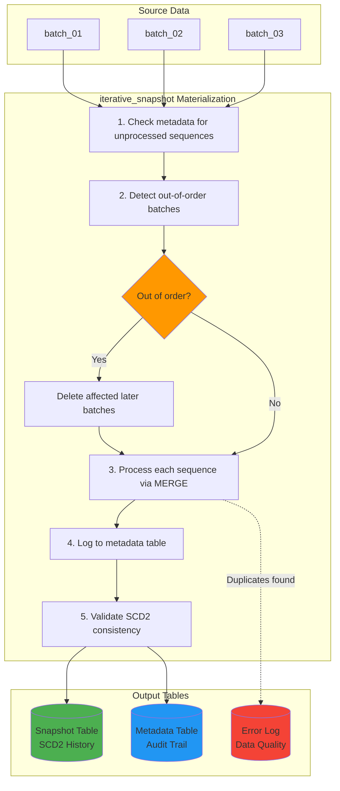
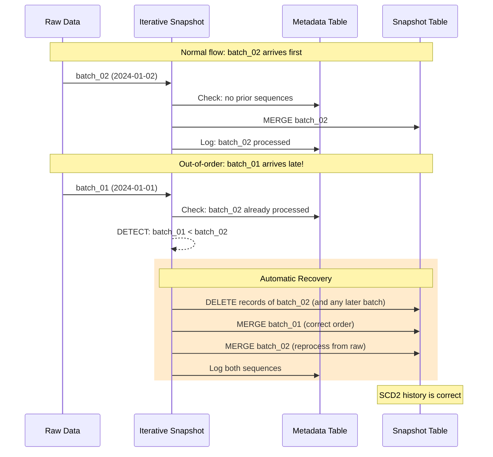

# How It Works

## The Problem

Standard dbt snapshots assume your source is a single live table that you query once per run. Many real-world pipelines instead receive **sequential batches**: daily file exports, CDC streams, API syncs. Those batches don't always arrive in order.

```
Arrival order:    batch_01 → batch_03 → batch_02 (late!)
Correct order:    batch_01 → batch_02 → batch_03
```

**With standard dbt snapshots**, the late batch is applied on top of newer data, and the SCD2 history ends up with impossible timelines where changes appear *before* they happened.

**With `iterative_snapshot`**, the late batch is detected, the affected batches are reprocessed in the correct order, and the SCD2 history stays correct without manual work.

## When to Use It

| Your Scenario | Standard Snapshot | Iterative Snapshot |
|---------------|:-----------------:|:-----------------:|
| Source is a live database table (one snapshot per run) | Yes | — |
| Source is sequential batches (files, CDC, API syncs) | — | **Yes** |
| Batches can arrive out of order | Corrupts history | **Handled automatically** |
| Need to reprocess/backfill historical batches | Manual rebuild | **Built-in** |
| Want an audit trail of which batches were processed | — | **Included** |
| Need to know *which columns* changed per update | — | **`changed_attributes`** |

It addresses these long-standing dbt-core issues:

| dbt-core Issue | Problem | How It Is Solved |
|----------------|---------|------------------|
| [#7138](https://github.com/dbt-labs/dbt-core/issues/7138) | Non-chronological insertions corrupt SCD2 | Detects out-of-order sequences and reprocesses in correct order |
| [#9892](https://github.com/dbt-labs/dbt-core/issues/9892) | No way to backfill or rebase snapshots | Sequence-based processing + `--full-refresh` with history preservation |
| [#3878](https://github.com/dbt-labs/dbt-core/issues/3878) | Snapshots can't handle append-only sources | Processes one sequence at a time, preventing merge conflicts |

## Processing Flow

The model's `SELECT` returns **all batches still retained in the raw layer**. On every run the materialization:

1. Compares the sequences in the query with those recorded in the metadata table and picks the unprocessed ones.
2. Checks whether any of them is older than the latest processed sequence (out of order).
3. Processes each sequence in order: detects duplicates, builds a staging set, and MERGEs it into the snapshot.
4. Logs each processed sequence (with MERGE row counts) to the metadata table.
5. Validates and repairs the SCD2 timeline.



## Example: Processing Daily Batches

**Batch `2024-01-01`**:

| customer_id | name | status | batch_date |
|-------------|------|--------|------------|
| 1 | Alice | Active | 2024-01-01 |
| 2 | Bob | Active | 2024-01-01 |

**Batch `2024-01-02`**:

| customer_id | name | status | batch_date |
|-------------|------|--------|------------|
| 1 | Alice | Premium | 2024-01-02 |
| 3 | Carol | Active | 2024-01-02 |

**Resulting snapshot**:

| customer_id | name | status | dbt_valid_from | dbt_valid_to | dbt_change_type | changed_attributes |
|-------------|------|--------|----------------|--------------|-----------------|-------------------|
| 1 | Alice | Active | 2024-01-01 | 2024-01-02 | update | ["status"] |
| 1 | Alice | Premium | 2024-01-02 | NULL | insert | NULL |
| 2 | Bob | Active | 2024-01-01 | NULL | insert | NULL |
| 3 | Carol | Active | 2024-01-02 | NULL | insert | NULL |

When a record changes, its previous version is closed (`dbt_valid_to` is set) and marked with **why** it was closed: `dbt_change_type = 'update'` plus the list of `changed_attributes`, or `'delete'` for hard deletes. The new version is inserted as the current row with `dbt_change_type = 'insert'`.

## Out-of-Order Handling



Reprocessed batches are re-read from the raw source. With `invalidate_hard_deletes=true`, snapshot rows of later batches that are no longer present in raw are backed up first and restored during reprocessing.

## Full Refresh

`dbt run --full-refresh` (or `full_refresh=true` in the model config) rebuilds the snapshot from the raw data currently available:

1. Snapshot rows whose sequence is no longer in raw (outside the retention window) are backed up.
2. The snapshot table is dropped and its metadata entries are cleared.
3. All sequences in raw are processed again with the current configuration.
4. The backed-up historical rows and their metadata entries are restored.
