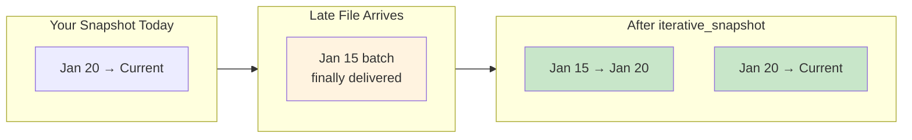
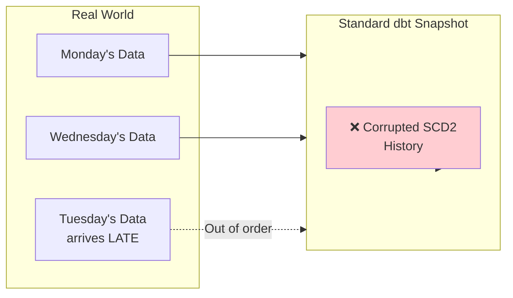
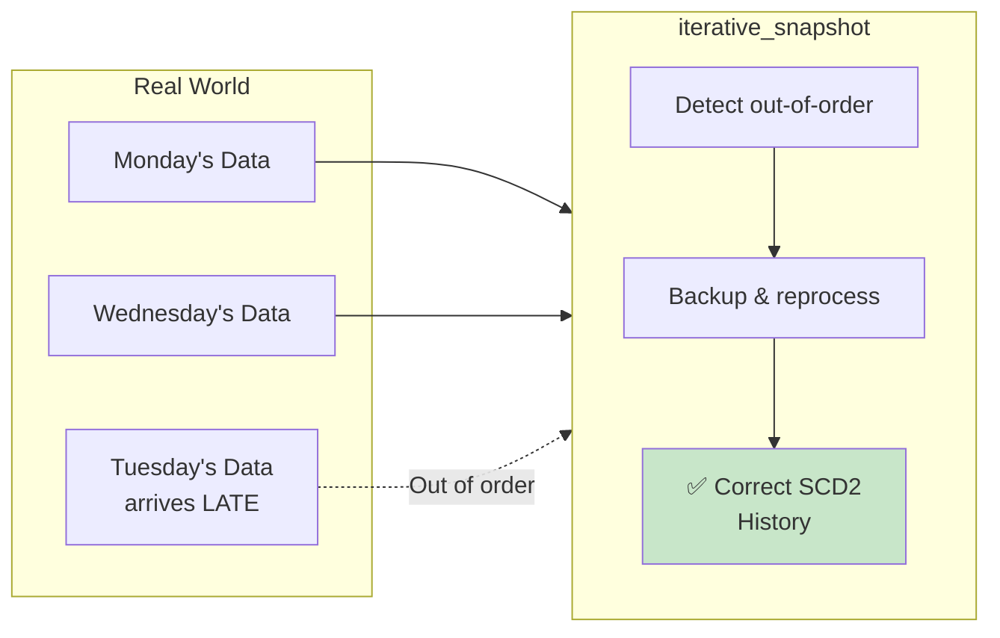
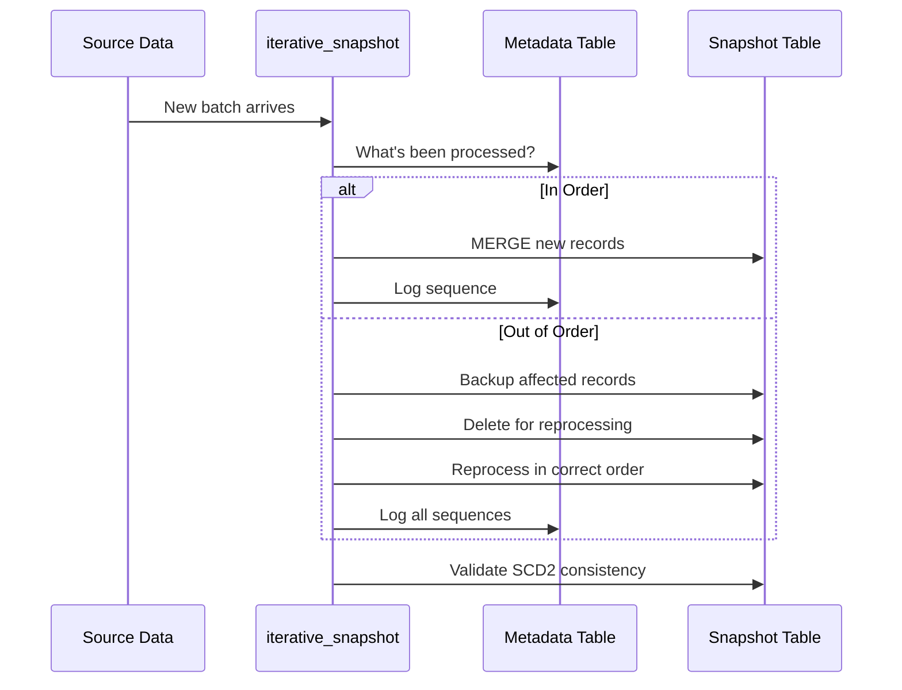

# dbt-iterative-snapshot

## Solving the Out-of-Order Data Problem for SCD2 Snapshots

**Mercedes-Benz Open Source Contribution**

---

## Why This Package Exists: The 3 Guarantees

> **Standard dbt snapshots assume your data arrives in order. Real-world data doesn't.**

### 1. Safe Backfill — Load Historical Data Without Fear



**The killer feature**: Backfill a month-old file and the package automatically:
- Backs up all affected records
- Reprocesses everything from the backfill point forward
- Restores correct SCD2 validity ranges
- **Zero data loss, zero manual intervention**

### 2. Self-Healing History — Out-of-Order Detection

When Tuesday's batch arrives after Wednesday's:
- Standard snapshot: **Corrupted timeline** (changes appear before they happened)
- iterative_snapshot: **Auto-detected and corrected** (reprocesses in proper sequence)

### 3. Audit-Ready Point-in-Time — Compliance Confidence

Every batch is logged with metadata. Auditors ask "what was the state on date X?" — you answer with certainty, not guesswork.

---

## Who Needs This?

| If You Have... | You Need iterative_snapshot |
|----------------|:---------------------------:|
| Daily file exports (HR, Finance, ERP) | ✅ |
| CDC streams that can arrive late | ✅ |
| Vendors with unreliable delivery schedules | ✅ |
| Compliance requirements for audit trails | ✅ |
| Historical corrections from source systems | ✅ |
| Disaster recovery / reload scenarios | ✅ |

---

## The Business Value (30-Second Pitch)

> **"We stopped losing sleep over late-arriving data."**
>
> Before: Manual rebuilds, data corruption, audit failures, weekend firefighting.
>
> After: Self-healing snapshots that handle out-of-order data automatically. Sleep well.

**Enterprise impact at Mercedes-Benz:**
- **100+ data products** using iterative snapshots
- **Zero data corruption** incidents since deployment
- **Hours saved** per incident that no longer requires manual intervention

---

## The Problem We Solved

### Every Data Team Faces This



**When data arrives out of order, standard dbt snapshots produce incorrect history.**

Records appear to change *before* they actually did. Downstream analytics and ML models are built on lies.

---

## Our Solution



**Automatic detection and self-healing.** No manual intervention required.

---

## Key Differentiators

| Feature | Standard Snapshot | iterative_snapshot |
|---------|:-----------------:|:------------------:|
| Sequential batch processing | ❌ | ✅ |
| Out-of-order detection | ❌ | ✅ |
| Automatic reprocessing | ❌ | ✅ |
| Batch audit trail | ❌ | ✅ |
| History preservation on full-refresh | ❌ | ✅ |
| Hard delete tracking | ✅ | ✅ |
| Change attribute tracking | ❌ | ✅ |

---

## Community Demand

**Long-standing dbt-core issues we solve:**

| Issue | Title | Open Since | Stars |
|-------|-------|-----------|-------|
| [#7138](https://github.com/dbt-labs/dbt-core/issues/7138) | Non-chronological insertions corrupt history | 2023 | High engagement |
| [#9892](https://github.com/dbt-labs/dbt-core/issues/9892) | No way to backfill historical snapshots | 2024 | Active discussion |
| [#3878](https://github.com/dbt-labs/dbt-core/issues/3878) | Snapshots can't handle append-only tables | 2021 | 50+ comments |

**We're not inventing a problem — we're solving one the community has been asking about for years.**

---

## How It Works



---

## Simple to Use

```sql
{{ config(
    materialized='iterative_snapshot',
    unique_key='customer_id',
    updated_at='modified_date',
    sequence_by='batch_date',  -- The magic ingredient
    strategy='check',
    check_cols=['name', 'status', 'email']
) }}

SELECT * FROM {{ source('raw', 'customers') }}
```

**One config option (`sequence_by`) unlocks the entire capability.**

---

## Production-Hardened

### Battle-tested at Mercedes-Benz

- **100+ data products** using iterative snapshots
- **Millions of records** processed daily
- **Zero data corruption** incidents since deployment
- **Sub-second detection** of out-of-order sequences

### Enterprise Features

- **Data Quality Monitoring**: Automatic duplicate detection
- **Error Logging**: Full audit trail of data issues
- **Schema Evolution**: Handles source changes gracefully
- **History Preservation**: Full-refresh doesn't lose old data

---

## Target Audience

### Primary

1. **Data Engineers** building data warehouses on Databricks
2. **Analytics Engineers** using dbt for transformation
3. **Teams processing batch files** (daily exports, CDC, etc.)

### Use Cases

- Daily HR/Finance data exports
- CDC streams from operational databases
- API data syncs with varying delivery times
- Any scenario where data arrives out of chronological order

---

## Competitive Landscape

| Solution | Approach | Limitation |
|----------|----------|------------|
| Standard dbt snapshot | Live table assumption | No out-of-order support |
| Custom SQL workarounds | Manual reprocessing | Error-prone, no audit trail |
| Elementary data | Data quality focus | Doesn't fix the data |
| **iterative_snapshot** | **Self-healing SCD2** | **Databricks-only (for now)** |

**We're the only solution that automatically detects AND fixes the problem.**

---

## Open Source Strategy

### Why Open Source?

1. **Community adoption** drives feature requests and improvements
2. **dbt Hub visibility** reaches thousands of data practitioners
3. **Industry goodwill** for Mercedes-Benz engineering brand
4. **Potential for dbt-core integration** if widely adopted

### Contribution Model

- MIT License (maximum adoption)
- Clear contribution guidelines
- Automated CI/CD pipeline
- Responsive issue triage

---

## Roadmap

### v1.0 (Current Release)

- ✅ Core iterative snapshot materialization
- ✅ Out-of-order detection and reprocessing
- ✅ Metadata tracking and audit trail
- ✅ Data quality monitoring
- ✅ Databricks/Unity Catalog support

### v1.x (Future)

- 🔲 Snowflake adapter
- 🔲 BigQuery adapter
- 🔲 Redshift adapter
- 🔲 Performance optimizations for very large batches
- 🔲 Integration with dbt Cloud

### Long-term Vision

- Propose to dbt-core as native feature
- Become the standard solution for batch-based SCD2

---

## Success Metrics

### Adoption Targets

| Metric | 3 months | 6 months | 12 months |
|--------|----------|----------|-----------|
| GitHub Stars | 50 | 200 | 500 |
| dbt Hub installs | 100 | 500 | 2000 |
| Community PRs | 5 | 15 | 30 |
| Issues resolved | 10 | 30 | 75 |

### Quality Metrics

- Zero critical bugs in production
- <24 hour response time on issues
- All PRs reviewed within 72 hours

---

## Call to Action

### For the dbt Community

1. **Try it** in your next project
2. **Star the repo** if it helps you
3. **Report issues** — we respond fast
4. **Contribute** — we welcome PRs

### For Databricks Users

This is **built for you**:
- Native Delta Lake MERGE operations
- Unity Catalog 3-part naming
- Liquid clustering support
- Auto-optimize table properties

---

## Get Started in 60 Seconds

```yaml
# packages.yml
packages:
  - package: mercedes-benz/dbt_iterative_snapshot
    version: [">=1.0.0", "<2.0.0"]
```

```bash
dbt deps
```

```sql
{{ config(
    materialized='iterative_snapshot',
    unique_key='id',
    updated_at='updated_at',
    sequence_by='batch_date',
    strategy='check',
    check_cols='all'
) }}

SELECT * FROM {{ source('raw', 'my_data') }}
```

**That's it. Your SCD2 history is now self-healing.**

---

## Links

- **GitHub**: [github.com/mercedes-benz/dbt-iterative-snapshot](https://github.com/mercedes-benz/dbt-iterative-snapshot)
- **dbt Hub**: [hub.getdbt.com/mercedes-benz/dbt_iterative_snapshot](https://hub.getdbt.com/mercedes-benz/dbt_iterative_snapshot)
- **Documentation**: [README.md](../README.md)
- **Contributing**: [CONTRIBUTING.md](../CONTRIBUTING.md)

---

## Thank You

**Mercedes-Benz Group AG**  
Mercedes-Benz Data Engineering Team

*Making data engineering better, one snapshot at a time.*
